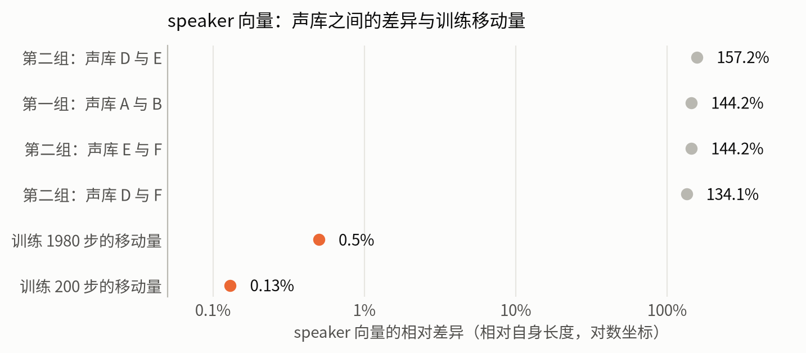
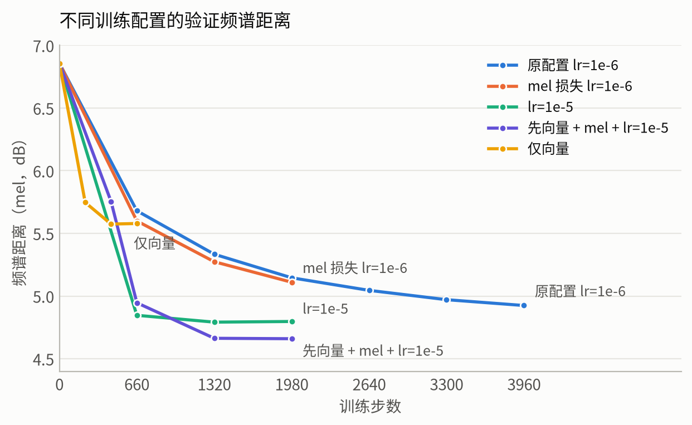
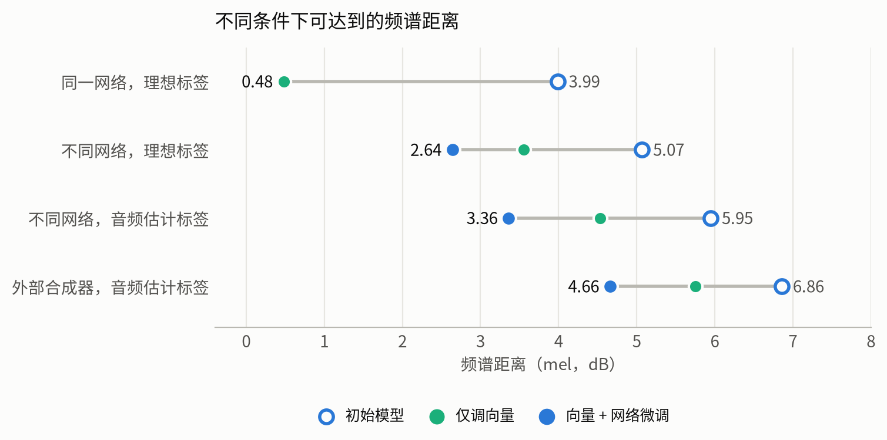
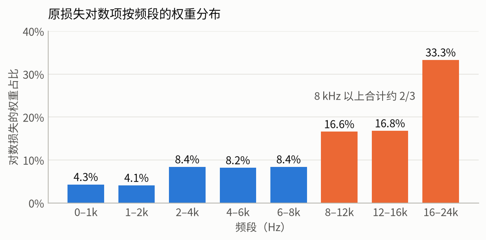
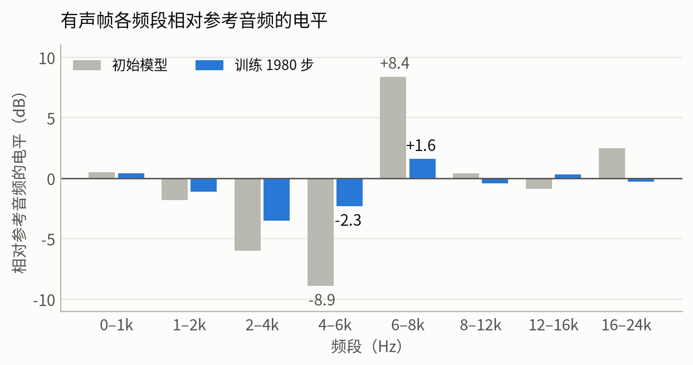
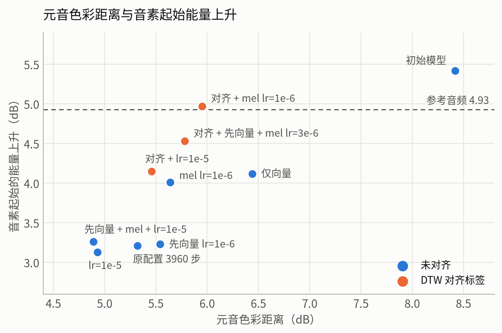
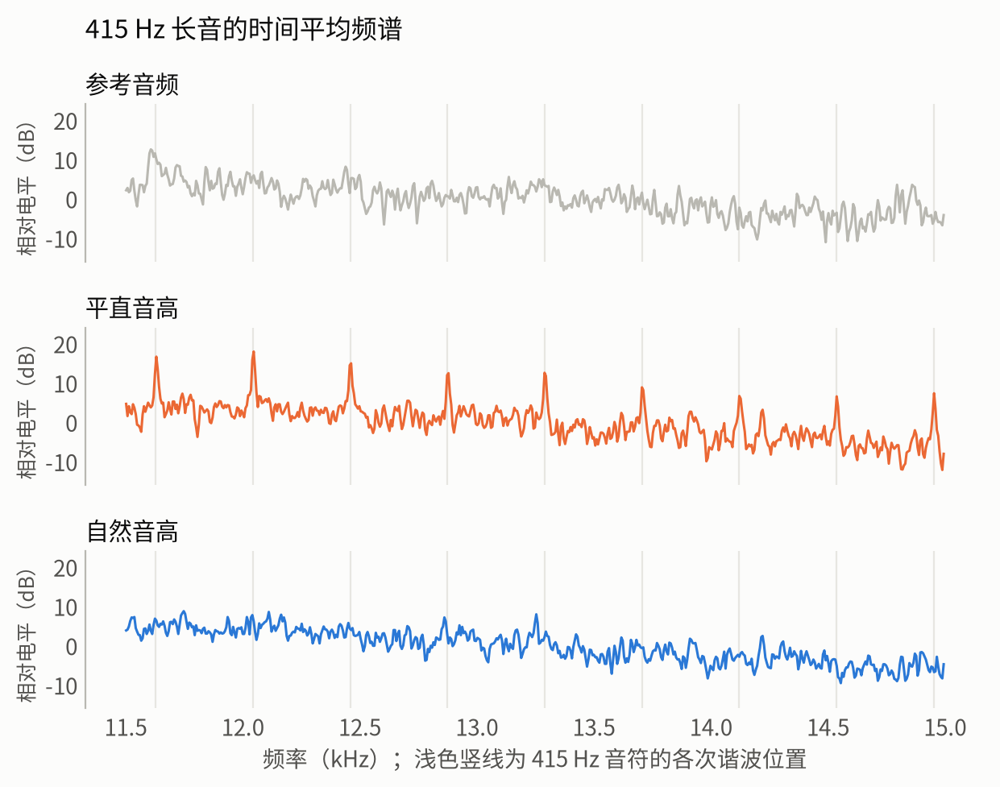
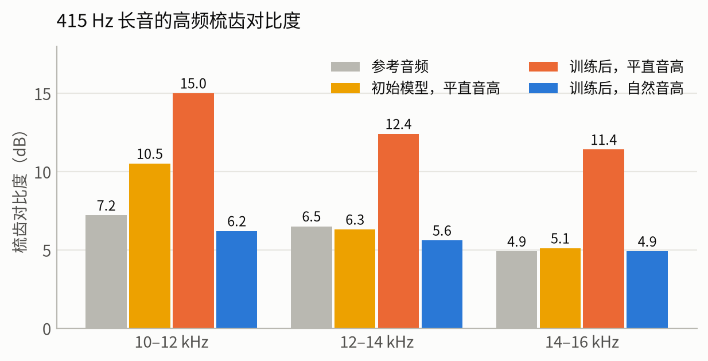

# OpenSV 音频监督训练：相似度不足与高频啸叫问题分析

## 摘要

本文分析 OpenSV 音频监督训练的两个问题：训练结果与参考音频的相似度不足，以及平直音高下的持续高频啸叫。

- 6 个已发布声库中，同组声库的网络权重数值完全相同，声音差异只在向量参数中（示例的两个声库相差 356 个）。原训练配置使 speaker 向量移动 0.5%，而声库之间相差 134–157%。
- 在同一网络和理想标签下，只用音频损失，200 步可将频谱距离从 3.99 dB 降到 0.48 dB。
- 学习率提高到 1e-5 后，验证误差约 1300 步后不再下降，训练误差继续下降。
- 频谱距离的最大来源是参考音频超出向量可表达的范围（约 2.2 dB），标签改为从音频估计增加约 0.7 dB。
- 训练强度增加时，元音色彩距离下降，音素起始能量也下降。DTW 对齐可恢复起始能量，但元音色彩距离上升。
- 啸叫与平直音高下 12 kHz 以上的规则谐波梳齿对应。在 415 Hz 长音上，12–14 kHz 的梳齿对比度：参考音频 6.5 dB，初始模型 6.3 dB，训练后 12.4 dB，训练后加自然音高 5.6 dB。

以上结果来自一首验证歌曲和一个随机种子，局限见第 4 节。

## 1. 实验条件

声学模型输出 71 维特征，经固定声码器生成音频，由音频损失更新声学模型。所有训练只用音频作为监督信号。时长模型、F0 模型和声码器不参与训练。

| 项目 | 内容 |
|---|---|
| 初始模型 | 第一组网络中的一个声库 |
| 参考音频 | 外部合成器生成的单人歌声 |
| 训练集 | 99 个片段，约 7.45 分钟 |
| 验证集 | 22 个片段，约 1.27 分钟，来自另一首歌 |
| 不同网络的参考声库 | 第二组网络中的一个声库 |

| 指标 | 定义 | 方向 |
|---|---|---|
| 频谱距离 | 2048 点 STFT、40 Hz–16 kHz、下限 −60 dB 的对数 mel 绝对差 | 越低越接近参考音频 |
| 元音色彩距离 | 长音素稳定段去除电平后的频谱形状差异，不受时间错位影响 | 越低越接近参考音频 |
| 起始能量上升 | 音素起始处 10 毫秒内 1–8 kHz 能量的最大上升 | 参考音频为 4.93 dB |
| 高频变化比 | 2 kHz 以上有声帧的频谱变化量，模型除以参考音频 | 低于 1 表示变化被抹平 |
| 梳齿对比度 | 长音上谐波位置与谐波间隙的电平差 | 参考音频在 12–14 kHz 约为 4–7 dB |

这些指标不等同于听感相似度。元音色彩距离和起始能量上升只统计 3 个最长片段。

## 2. 结果

### 2.1 声音差异集中在少量向量参数

比较 6 个已发布声库的解码后张量，它们分为两组，组内网络权重数值完全相同。第一组中两个声库的差异如下（style 行数因声库而异）：

| 模型 | 总参数 | 差异参数 |
|---|---:|---|
| 声学 | 1095 万 | 196（speaker 32、style 行 160、系数 4） |
| 时长 | 213 万 | 128 |
| F0 | 390 万 | 32 |
| 声码器 | 281 万 | 整套不同，部分声库共用同一套，存在跨组共用 |

**图 1：** 同组声库的 speaker 向量相差 134–157%。训练 1980 步（学习率 1e-6）后 speaker 向量移动 0.50%，style 向量移动 0.33%，网络各部分移动 0.13–1.75%。

### 2.2 音频损失可恢复向量

使用同一网络和理想标签，将被训练模型的向量偏移一个同组声库间距，再只用音频损失优化：

| 步数 | 频谱距离 | speaker 与真值之差 | style 与真值之差 |
|---:|---:|---:|---:|
| 0 | 3.99 dB | 144% | 124% |
| 100 | 0.78 dB | 44% | 65% |
| 200 | 0.48 dB | 5.6% | 29% |
| 500 | 0.48 dB | 4.6% | 12% |

此测试的两侧共用同一串声码器噪声，0.48 dB 偏低。

### 2.3 训练配置对比

| 配置 | 训练范围 | 学习率 | 损失 | 对齐 | 步数 | 频谱距离 | 音符 F0 下 | 高频变化比 | 起始能量 | 元音色彩 |
|---|---|---|---|---|---:|---:|---:|---:|---:|---:|
| 初始模型 | 不训练 | | | | 0 | 6.86 | 7.34 | 1.02 | 5.42 | 8.42 |
| 仅向量 | 64 个参数 | 3e-3 | 原损失 | 否 | 660 | 5.58 | 6.25 | 0.91 | 4.12 | 6.44 |
| 原配置 | 全部 | 1e-6 | 原损失 | 否 | 3960 | 4.93 | 5.70 | 0.79 | 3.21 | 5.32 |
| mel 损失 | 全部 | 1e-6 | mel | 否 | 1980 | 5.11 | 5.86 | 0.87 | 4.01 | 5.64 |
| 先向量 | 向量后全部 | 1e-6 | 原损失 | 否 | 1980 | 5.06 | 5.86 | 0.81 | 3.23 | 5.54 |
| 高学习率 | 全部 | 1e-5 余弦 | 原损失 | 否 | 1980 | 4.80 | 5.58 | 0.80 | 3.13 | 4.93 |
| 先向量 + mel + 高学习率 | 向量后全部 | 1e-5 余弦 | mel | 否 | 1980 | 4.66 | 5.47 | 0.82 | 3.26 | 4.89 |
| 高学习率 + 对齐 | 全部 | 1e-5 余弦 | 原损失 | 是 | 1980 | 4.90 | 5.66 | 0.88 | 4.15 | 5.46 |
| mel + 对齐 | 全部 | 1e-6 | mel | 是 | 1980 | 5.23 | 5.98 | 0.95 | 4.97 | 5.95 |
| 中间学习率 + 对齐 | 向量后全部 | 3e-6 余弦 | mel | 是 | 1980 | 5.05 | 5.83 | 0.93 | 4.53 | 5.78 |

**图 2：**

- `lr=1e-5` 在 660 步的频谱距离为 4.85 dB，原配置在 3960 步为 4.93 dB。
- `lr=1e-5` 的验证损失在 1320 步后保持在 1.45，训练损失从 1.22 降到 1.19。
- 仅向量配置的元音色彩距离为 6.44 dB，全部参数训练的最低值为 4.89 dB。
- 先向量加 mel 损失与直接提高学习率相比，元音色彩距离相差 0.04 dB，频谱距离相差 0.14 dB。

### 2.4 频谱距离的来源

**图 3：** 放宽条件时频谱距离的变化：

| 条件变化 | 增加量 | 含义 |
|---|---:|---|
| 同一网络变为不同网络 | 约 2.2 dB | 参考音频超出向量可表达的范围 |
| 理想标签变为音频估计标签 | 约 0.7 dB | 对齐和 F0 从音频估计 |
| 不同网络变为外部合成器 | 约 1.3 dB | 合成方式不同；训练素材量也不同，此值为粗略估计 |

### 2.5 损失权重与频段电平

**图 4：** 原损失的对数项对每个频率格等权，8 kHz 以上约占 2/3，16–24 kHz 占 1/3，0–2 kHz 占 8.4%。训练后，有声帧 0–2 kHz 的误差从约 9 dB 降到 7.4 dB，4–6 kHz 从 13.6 dB 降到 9 dB。

**图 5：** 训练后 4–6 kHz 的电平相对初始模型上升，但相对参考音频仍低 2.3 dB。

### 2.6 起始能量与元音色彩

**图 6：**

- 起始能量：初始模型 5.42 dB，仅向量 4.12 dB，`lr=1e-5` 3.13 dB，参考音频 4.93 dB。
- 使用 DTW 对齐标签后，`lr=1e-5` 从 3.13 dB 升到 4.15 dB，`lr=1e-6` 的 mel 配置从 4.01 dB 升到 4.97 dB。
- 同样两组配置的元音色彩距离分别从 4.93 dB 升到 5.46 dB，从 5.64 dB 升到 5.95 dB。
- 高频变化比也随对齐上升（0.80 到 0.88，0.87 到 0.95）。

对齐标签只影响训练。在估计时长下，`lr=1e-5` 对齐配置的频谱距离为 4.90 dB，未对齐配置为 4.80 dB；在对齐时长下，对齐配置为 4.33 dB。

### 2.7 高频啸叫

听感现象：平直音高下存在持续的高频啸叫，高音时更明显。

| 听感测试 | 结果 |
|---|---|
| 低通滤波 | 截止频率为 12 kHz 时啸叫明显减弱 |
| 只听谐波路 | 啸叫明显 |
| 声码器用平直音高，模型用真实音高 | 啸叫明显 |
| 模型用平直音高，声码器用真实音高 | 有啸叫，程度较轻 |
| 平直音高加 25 音分颤音 | 啸叫明显减弱 |

时频图上看不出差异，长音的时间平均频谱可以看出：

**图 7：** 平直音高下，频谱在各次谐波位置出现尖峰。自然音高和参考音频没有这种规则尖峰。

**图 8：** 415 Hz 长音的结果。下表为三段长音 12–14 kHz 的梳齿对比度（dB）：

| 长音 | 参考音频 | 初始模型，平直音高 | 训练后，平直音高 | 训练后，自然音高 |
|---|---:|---:|---:|---:|
| 415 Hz | 6.5 | 6.3 | 12.4 | 5.6 |
| 370 Hz（第一段） | 4.2 | 8.0 | 9.1 | 5.6 |
| 370 Hz（第二段） | 4.3 | 8.2 | 11.6 | 4.6 |

处理方式的听感对比：

| 处理 | 听感 |
|---|---|
| 不处理 | 明显啸叫 |
| 去除谐波路 12 kHz 以上 | 啸叫减弱，有频带截断感 |
| 自然音高 | 啸叫明显减弱 |
| 自然音高 + 去除谐波路 12 kHz 以上 | 啸叫明显减弱，与上一项无明显差别 |

自然音高在音符音高上加入滑音、延迟颤音和微小漂移，只依据乐谱计算。

### 2.8 修改后的完整流程

**自然音高。** 用 OpenSV 引擎渲染，6 个长音的平均梳齿对比度（dB）：

| 版本 | 10–12 kHz | 12–14 kHz | 14–16 kHz |
|---|---:|---:|---:|
| 初始模型，平直音高 | 8.4 | 9.3 | 7.0 |
| 初始模型，自然音高 | 5.2 | 5.7 | 4.9 |
| 训练后，平直音高 | 19.5 | 18.3 | 14.9 |
| 训练后，自然音高 | 11.1 | 10.6 | 6.7 |

**完整流程。** 用不同网络的参考声库渲染音频（自然音高），做 DTW 对齐（音素边界平均移动 7.7 毫秒），训练（mel 损失，先向量 440 步，`lr=3e-6`，余弦衰减，共 1980 步），导出后再用引擎渲染。验证歌曲的结果：

| 指标 | 初始模型 | 训练后 | 参考声库 |
|---|---:|---:|---:|
| 片段级频谱距离（实测 F0、对齐标签） | 6.06 dB | 3.54 dB | |
| 整首歌频谱距离（各用自身时长） | 4.92 dB | 2.59 dB | |
| 2–4 kHz 相对参考声库 | −2.7 dB | −0.6 dB | |
| 4–6 kHz 相对参考声库 | −3.8 dB | −1.2 dB | |
| 6–8 kHz 相对参考声库 | −4.7 dB | −1.4 dB | |
| 8–12 kHz 相对参考声库 | −4.1 dB | −1.1 dB | |
| 12–18 kHz 频谱平坦度 | −6.53 dB | −6.84 dB | −7.24 dB |
| 音量（RMS） | 0.118 | 0.094 | 0.095 |

两侧使用同一个自然音高生成器和种子，整首歌的距离偏低。

### 2.9 已排除的因素

| 因素 | 证据 |
|---|---|
| 模型记住固定噪声 | 更换噪声后损失从 1.5074 变为 1.5064 |
| 静音帧主导损失 | 静音帧约占时频格的 1% |
| 响度未对齐 | 差异为 1–3.5 dB，影响小 |
| 4–6 kHz 能量过量 | 训练后仍比参考音频低 2.3 dB |
| 声门参数 Rd 导致脉冲变尖 | 替换回初始值后波形指标基本不变 |
| 声码器不合适 | 更换声码器后频谱距离为 5.585 dB，原为 5.575 dB |
| 训练步数不足 | 高学习率下验证误差已停止下降 |
| 啸叫为瞬时单音 | 听感测试确认啸叫持续存在 |
| 啸叫来自 2.2 kHz 窄峰或 4–6 kHz 谐波 | 低通到 12 kHz 时啸叫明显减弱 |
| 16 kHz 以上能量失控 | 该频段比参考音频低 3.7 dB |

## 3. 未解决的问题

- **配置之间的啸叫差异。** `lr=1e-5` 和 mel 损失配置在平直音高下的梳齿对比度（12–14 kHz 为 15.1 和 12.7 dB）也较高，但听感上啸叫最明显的是"先向量 + mel + 高学习率"配置。梳齿对比度能区分平直与自然音高，不能区分这些配置。
- **指标与听感不一致。** "mel 损失"配置听感最自然，但频谱距离不是最低。频谱距离最低的配置啸叫最明显，咬字也较含混。
- **音色偏粗、偏哑。** 听感测试中有此描述，长音素各频段平均差异约 1 dB，尚无对应指标。
- **4–10 kHz 梳齿。** 自然音高下，4–8 kHz 的对比度仍可能高于参考音频（一段长音上为 22.9 对 7.5 dB）。
- **脉冲包络。** 2–6 kHz 的包络深度训练后为 0.63，参考音频为 0.565，与听感的关系未确认。高频脉冲峰值与嗡声的关系见文献 [1]。
- **训练后的高频梳齿。** 自然音高下，训练后 12–14 kHz 的对比度仍高于初始模型（10.6 对 5.7 dB）。

## 4. 局限

- 只有一首验证歌曲，且曾用于选择模型，没有独立测试集。
- 只有一个随机种子，0.1 dB 以内的差异不作区分。
- 元音色彩距离和起始能量上升只统计 3 个片段，梳齿对比度只统计少量长音。
- 听感测试人数少，未盲测。部分对比在试听前已告知比较内容；"mel 损失"与"mel + 对齐"之间，听者无法独立分辨差异。
- 参考音频均为合成音，结论不能直接外推到真人录音。
- 第 2.4 节各条件的验证片段切分和素材量不完全相同，差值为粗略估计。

## 5. 代码修改

| 修改 | 选项 |
|---|---|
| 自然音高 | `opensv render --pitch-mode natural` |
| DTW 音素对齐 | `opensv-prepare --align` |
| mel 损失 | `--loss mel_v1` |
| 先训练向量 | `--embed-steps`、`--embed-lr` |
| 只训练向量 | 音频监督下的 `--scope embeddings` |
| 学习率余弦衰减 | `--cosine` |

## 6. 结论

- 原配置基本未移动声音身份所在的向量，学习率提高后，验证误差会达到平台。
- 平台之后的频谱距离主要来自参考音频超出向量可表达的范围。标签从音频估计带来的增量较小。
- 元音色彩距离和起始能量之间存在取舍，DTW 对齐可恢复起始能量。
- 高频啸叫与平直音高下的规则谐波梳齿对应，训练会加强梳齿，自然音高可以减弱，但不能完全消除。

## 参考文献

1. McCree, A. V., Barnwell, T. P. A Mixed Excitation LPC Vocoder Model for Low Bit Rate Speech Coding. IEEE Transactions on Speech and Audio Processing, 1995.
